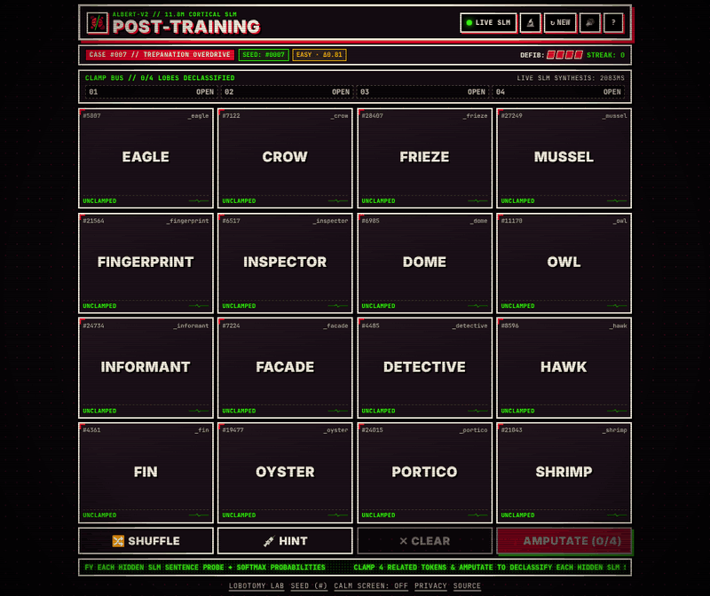

# POST-TRAINING

**[post-training.win](https://post-training.win/)** · **[Privacy Policy](https://post-training.win/privacy.html)**

<p align="center">
  
</p>

A 90s comic-gore word connection game powered by a tiny on-device Small Language Model (`Xenova/albert-base-v2`, 11.8M parameters, ~22 MB fp16 ONNX) running **100% client-side in your browser** via WebAssembly.

Inspired by classic 4×4 word-grouping puzzles, edge keyboard next-word prediction models, and the visceral black-ink / crimson / acid-green aesthetic of 1990s underground splatter comics.

---

## How It Plays

Our patient — a compact 11.8M-parameter transformer running inside your browser — has suffered catastrophic synaptic entanglement. Four **Cortical Sentence Probes** (each with a `[MASK]` slot) are firing at once, and **16 vocabulary tokens** are floating loose on the operating table.

1. **Select 4 Tokens & Amputate:** Group the 4 tokens on the 4×4 grid that belong to one category and hit **🩸 AMPUTATE** (or press `Enter`). Four misfires and the patient flatlines.
2. **Declassify the Hidden SLM Probes:** While you solve, the 4 cortical sentence probes and token probabilities are encrypted. Each time you amputate a category, its cortical lobe banner rips open to reveal the exact **sentence completion probe** (for example: `"the best ice cream flavor is [MASK]."`) along with the language model's **softmax probability (`%`)** and **raw logit (`z`)** for each of the 4 words.
3. **One Solution, Planted Decoys:** Before a board is dealt, the game searches for any *second* way to split the 16 tokens that the model's logits would also accept, and evicts tokens until exactly one solution survives. **Red herrings** — tokens a rival probe scores as highly as its own members (`HOTEL` on a board with both *places to live* and *rooms of a house*) — are kept on purpose.
4. **Entanglement Tiers I–IV:** Each lobe is ranked by the logit gap between its weakest member and the strongest rival token. Tier I is a clean cut; tier IV is the most entangled lobe on the table. Severing IV first earns bonus XP.
5. **💉 Biopsy (3 per case):** Clamp a token and press `B` to read its **activation signature**: four bars showing how hard each hidden probe α β γ δ fires for that token. Tokens with matching signatures share a lobe; a red herring lights two bars.
6. **📅 Daily Case:** One shared board per calendar day (`?daily=YYYY-MM-DD`), identical for everyone because it is dealt from the committed logit tables. Monday is easy; the weekend is hard.
7. **Post-Op Autopsy:** Every finished case shows the full **16-token × 4-probe logit heatmap**, the red herrings the model fell for, an XP breakdown, a spoiler-free share grid (`░▒▓█` = tier I→IV per guess), and one newly declassified **Field Note**.
8. **Two Operating Modes:**
   - **LIVE SLM SURGERY (On-Device Procedural):** Every seed rolls 4 cortical lobes and a prompt variant for each, runs 4 real-time ONNX forward passes in your browser, and lets the language model select its own tokens from a 1,400-word pool on the fly.
   - **PRE-DISSECTED WARD (`?lite=1`):** Instant verified logit tables so you can play immediately while the 22 MB ONNX model boots (or on ultra-low-memory mobile tabs).
9. **🔬 Live Lobotomy Lab:** Open the Lab at any time to type **any custom sentence** and inspect both the current board's rankings and the model's raw top predictions across its entire **30,000-token vocabulary** — or write **4 custom sentences of your own** and let the SLM synthesize a playable 4×4 board from scratch!

### 148 lobes, including grammar

The corpus holds **148 cortical lobes** (444 prompts, ~1,400 single-token words). Alongside topical lobes (*chess board*, *ship anatomy*, *oyster bar*) sit everyday taxonomies (*colors*, *months*, *nations*, *family tree*) and pure **grammar lobes** — *modal verbs*, *spatial prepositions*, *comparatives*, *superlatives*, *question words*, *past-tense motion verbs*. Nobody taught the model grammar; those groups fall out of its statistics, which makes them both the sneakiest categories and the best lesson.

### What you learn while you play

The **Field Notes** are a 20-step curriculum unlocked one case at a time and illustrated with live numbers from the board you just solved: tokens → masked language modeling → logits → softmax → context → polysemy → attention → embeddings → cosine distance → parameters → pre- vs. post-training → quantization → on-device inference → prompt sensitivity → frequency bias → learned grammar → sampling & temperature → hallucination → models grading models → scale.

---

## Development & Testing

```bash
npm ci                                   # Install Playwright, ESLint, TypeScript, serve
npm run serve                            # Start local server on http://localhost:3000
npm run lint                             # ESLint + TypeScript + Ruff + puzzle validator
npm run test:unit                        # Python unit + ONNX verification tests
npm test                                 # Full Playwright E2E suite (Chromium, Firefox, WebKit, Mobile Safari)
```

---

## Privacy

**POST-TRAINING** runs 100% on your device. There is no backend server, no analytics, no cookies, and no telemetry. Only `localStorage` and `sessionStorage` are used to save your seed, streak, stats, and UI preferences locally. See [privacy.html](privacy.html).

## License

Code: [MIT](LICENSE). Model weights (`models/Xenova/albert-base-v2/`): Apache 2.0.
